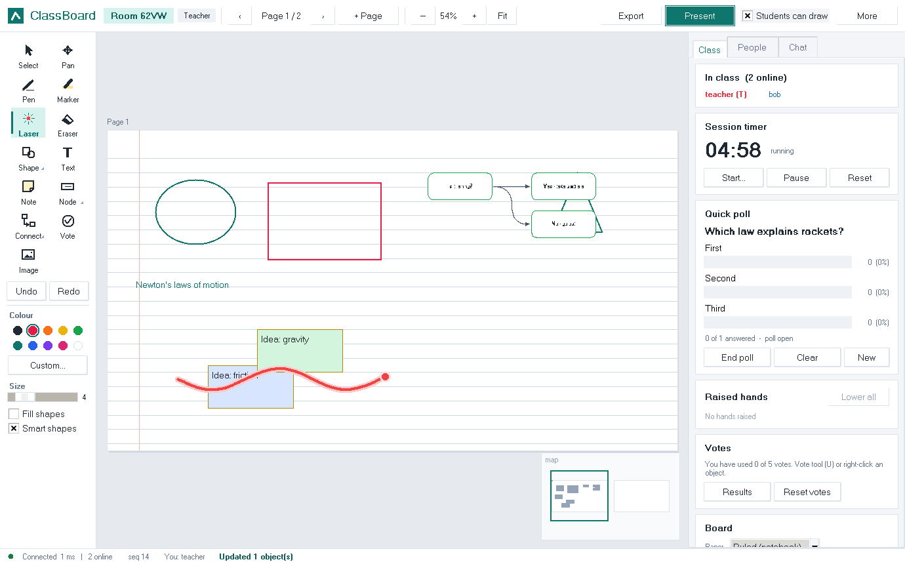

# ClassBoard: LAN collaborative whiteboard for teaching

ClassBoard is a real-time shared whiteboard for a classroom. It works **only over a Local Area
Network** (Wi-Fi, Ethernet or a phone hotspot) and needs no internet connection. It is written
in Python 3 with `socket`, `threading` and `tkinter`.

* **Server**: one laptop runs `ClassBoard-Server` (or `python run_server.py`). It orders, validates,
  stores and broadcasts everything. It can host many classes (rooms) at once.
* **Client**: the teacher and every student run `ClassBoard-Client` (or `python run_client.py`)
  and connect to the server's LAN IP address over raw TCP sockets.

| For the teacher | For students | Under the hood |
|---|---|---|
| Pages, like a lesson: ruled, grid, dot or graph paper | See the teacher's board live, with no lag | One length-prefixed JSON protocol over TCP |
| **Present** mode: every student's view follows yours | **Raise hand**; private message to the teacher | Server-assigned global sequence numbers keep every screen identical |
| Laser pointer, pen, shapes, text, sticky notes | Answer **quick polls**; vote on ideas | Auto-reconnect with delta sync and offline edits |
| Flowcharts and mind maps (Tab = child, Enter = sibling) | Export all pages as **PDF notes** | Per-user undo/redo, version history |
| Lock the board, view-only students, own-work-only mode | Images, voice messages, video and files in chat | PBKDF2 passwords, optional TLS, validation and rate limits |
| Timer, polls, raised hands, votes in one **Class** panel | Infinite canvas with a minimap | zlib-compressed snapshots (85% smaller) |



---

## 1. Quick start

```bash
# 1. Server laptop
python run_server.py              # Windows: double-click start_server.bat (opens the dashboard)
#    -> prints e.g. "Clients can connect to: 192.168.43.17"   (TCP 5050, discovery UDP 5051)

# 2. Teacher and every student (the server laptop can also be one of them)
python run_client.py              # Windows: double-click start_client.bat
#    -> "Start a class" (teacher) or "Join a class" with the 4-letter room code
```

* Python 3.10+. Linux needs Tkinter: `sudo apt install python3-tk`.
* **Firewall:** on the server laptop, allow Python on *Private* networks, or run
  `tools\open_firewall_windows.bat` as Administrator. Make sure the Wi-Fi profile is *Private*.
* **One-laptop demo:** start the server, then two clients on `127.0.0.1`. To add simulated
  classmates, run `python tools/bot_swarm.py --room K7Q2 --bots 5`.

Optional packages (install them while you still have internet; the build scripts bundle them):

| Package | Adds | Without it |
|---|---|---|
| `pillow` | PNG/PDF export, JPEG/WebP images, pasting images with Ctrl+V | export falls back to `.eps`; PNG/GIF images only; SVG and board files always work |
| `sounddevice` | voice recording on any OS | Windows records anyway (built-in MCI); Linux uses `arecord` |

**Standalone executables** (build on each target OS; they run without Python):

| OS | Command | Output |
|---|---|---|
| Windows | `build_windows.bat` | `dist\ClassBoard-Server.exe`, `dist\ClassBoard-Client.exe` |
| Linux | `./build_linux.sh` | `dist/ClassBoard-Server`, `dist/ClassBoard-Client` |

### Server options

| Option | Meaning |
|---|---|
| `--dashboard` | live window: rooms, people, messages/s and KB/s in and out |
| `--stats 10` | print a traffic line every 10 s |
| `--tls-cert cert.pem --tls-key key.pem` | encrypt all traffic with TLS (`tools/gen_cert.sh` or `.bat` makes a certificate; students tick **Encrypted (TLS)**) |
| `--port 6000`, `--udp-port 6001` | other ports |
| `--save-dir boards` | folder for saved boards and shared files |
| `--no-discovery` | turn off UDP discovery |

Stop the server with **Ctrl+C**, or close the dashboard. Rooms are autosaved every 30 s and on
shutdown, and restored on the next start.

---

## 2. User guide

### Start or join a class

1. Start the client and type your name (1–20 letters, digits, `_` or `-`).
2. **Start a class** (teacher) or **Join a class** (student). Servers and classes on the network
   are found automatically by a UDP broadcast; click a class to fill in its code. If the list
   stays empty, type the IP address shown by the server.
3. The teacher can set a class password. The room code is shown at the top of the window
   (click it to copy).

Shortcuts for demos:

```bash
python run_client.py --host 192.168.1.20 --name teacher --create --password cnlab
python run_client.py --host 192.168.1.20 --name asha --room K7Q2 --password cnlab
```

### The window

* **Header:** room code, your role, page navigation (`‹ Page 2 / 5 ›`, teacher: **+ Page**),
  Undo/Redo, zoom, and then:
  * for the teacher: **Present** and **Students can draw**;
  * for students: **Raise hand**;
  * for everyone: **Export** and **More** (history, board files, authors, help).
* **Tool rail (left):** tools, colours, size, *Fill shapes*, *Smart shapes*.
* **Board:** white pages on a grey desk. It is an infinite canvas, so you can also draw between
  and around pages. The minimap is in the bottom-right corner.
* **Right panel:**
  * **Class:** timer, quick poll, raised hands, votes and board settings.
  * **People:** participants. Right-click a person for options.
  * **Chat:** *Everyone* plus one tab per private conversation, with files and voice messages.
* **Status bar:** connection, round-trip time, TLS, people online, last `seq`, and who made the
  object under the mouse.

### Tools

| Tool | Key | How |
|---|---|---|
| Select | V | Click to select (Shift adds); drag on empty space to select several. Drag to move. Use the corner handle to resize. Double-click or Enter edits text. Del deletes, Ctrl+D duplicates, Ctrl+A selects all. Picking a colour, size or fill restyles the selection. |
| Pan | H | Drag to move around. Also middle mouse, Space+drag or the wheel; Ctrl+wheel zooms. |
| Pen / Marker | P / M | Freehand / see-through highlighter. With **Smart shapes**, rough circles, rectangles, triangles and lines become perfect shapes. |
| Laser | K | Point at things without drawing. A red trail fades after a second and everyone sees it with your name. |
| Eraser | E | Drag over objects to erase them (undoable). |
| Shape | S | Rectangle, ellipse, triangle, diamond, line or arrow (click the tool again to choose). Shift gives a square or circle. |
| Text / Note | T / N | Click and type directly on the board. Enter finishes, Shift+Enter adds a new line, Esc cancels. |
| Node | F | Flowchart / mind-map node: rounded box, process, decision (diamond), input/output, start/end. |
| Connect | C | Drag from one node to another. Styles are arrow, line and curve (for mind maps). Double-click a connector to add a label such as *Yes* or *No*. |
| Image | I | Insert a picture, or paste one with **Ctrl+V** (pasted text becomes a text box). |
| Vote | U | Give an object one of your 5 votes; right-clicking also works. |

**Mind maps:** select a node, then press **Tab** for a child or **Enter** for a sibling. Type the
text and press Enter. Pressing Tab again continues one level deeper. Connectors re-route
automatically when nodes move.

**Who made this?** Hovering shows, for example, *"Node by asha - last edited by ravi - 2 votes"*.
**More → Show authors** tags every object with its creator's name.

### Teacher controls

| Where | Control | Effect |
|---|---|---|
| Header | **Present** | Every student's view follows your page, pan and zoom, with a banner. Their own pan and zoom are paused, but they can still draw and vote. |
| Header | **Students can draw** | Untick to make the board read-only for students (the board lock). |
| Header | **+ Page** | Adds a page to the lesson for everyone. |
| Class → Timer | Start / Pause / Reset | Shared countdown. It turns orange in the last 30 s and beeps at zero. |
| Class → Quick poll | New / End / Clear | Question with 2–6 options (quick presets: A–D, True/False, 1–5). Live bars; the teacher also sees who chose what. Students see results after answering. |
| Class → Raised hands | Lower / Message / Lower all | The teacher hears a beep when a hand goes up. |
| Class → Votes | Results / Reset votes | Ranking of the most-voted objects. |
| Class → Board | Paper | Plain, grid, ruled, dots or graph. |
| Class → Board | Own work only | Students can change only what they created. |
| Class → Board | Save / Load on server | Named versions stored on the server. |
| Class → Board | Open board file | Replaces the board with a file saved earlier. |
| Class → Board | Clear board | Undoable. |
| Class → Board | **End session** | Closes the class for everyone. |
| People (right-click) | Private message, Make view-only / Allow drawing, Make teacher, Remove | **Make teacher** hands over control. **Remove** kicks the student, who cannot rejoin. |

### For everyone

* **Version history** (Class tab or More): drag the slider through every change in the lesson,
  or press **Replay**. The teacher can restore an old version for everyone.
* **Export:** this page or the whole board as PNG, **all pages as PDF (class notes)**, or the
  whole board as SVG. **Ctrl+S** saves a board file that the teacher can open again in a later
  class.
* **Chat:** messages, images (with preview), voice messages (*Record voice*), videos, audio and
  any file up to 200 MB. Double-click a person (or right-click → *Send private message*) to
  open a private conversation. Unread messages are counted on the tab.
* **If the network drops**, the status bar shows *Reconnecting…* and everything keeps working
  locally. You get your seat, role and colour back, plus every change you missed. Anything you
  drew offline is sent once. If the server disappears, the client offers to save a copy of the
  board.

---

## 3. Architecture

```
  +-------------+   TCP 5050: length-prefixed JSON (zlib for big frames, optional TLS)
  | Teacher     |<-------------------------------+          +------------------------------+
  +-------------+                                |          |  Server                      |
  +-------------+                                +--------->|  accept thread               |
  | Student A   |<----------------------------------------->|  per client: reader thread   |
  +-------------+                                           |    + writer thread + queue   |
  +-------------+   extra short TCP connection per file     |  Room (one lock): seq, op    |
  | Student B   |<----------------------------------------->|    log, model, history,      |
  +-------------+   UDP 5051: "any servers here?" broadcast |    chat, DMs, poll, timer... |
                                                            |  housekeeping (grace, save)  |
                                                            |  discovery (UDP), dashboard  |
                                                            +------------------------------+
```

* **Server-authoritative star.** Clients never talk to each other. Every change goes to the
  server, which assigns the next global sequence number (`seq`) and broadcasts it to everyone,
  including the sender: that echo is the sender's acknowledgement.
* **Same model code on both sides.** `common/model.py` runs on the server and on every client.
  Applying the same ops, in the same order, with the same deterministic function gives
  identical boards. Tests compare board fingerprints across 5–10 clients.

### Transport and framing

* **TCP for all session traffic.** Strokes, edits, undo and chat must all arrive, and in order.
  On a LAN the extra latency is about a millisecond. `TCP_NODELAY` turns off Nagle's
  algorithm, and `SO_KEEPALIVE` is on.
* **UDP only for discovery**, because broadcast needs UDP and a lost discovery packet is
  harmless.
* **Framing:** each frame is a 4-byte big-endian length followed by UTF-8 JSON. `recv_exact()`
  loops until the frame is complete, which handles fragmentation; `FrameDecoder` handles
  frames that arrive coalesced.
  * Bodies over 32 KB (snapshots, history) are **zlib-compressed**, and the top bit of the
    length marks this. Inflating is capped at 32 MB, so a "zip bomb" is rejected.
  * Frames over 4 MB on the wire are refused before anything is allocated.
* **Files** (images, video, voice) use a **separate short-lived TCP connection** per transfer.
  A 100 MB video would otherwise block every stroke queued behind it (head-of-line blocking).
  Measured stroke latency during a 60 MB upload stayed at 0.4 ms. Uploads are checked with
  SHA-256.

### Messages (protocol version 2)

| Direction | Types |
|---|---|
| client → server | `HELLO` (create/join/reconnect, with `version`), board ops `STROKE` `MOVE` `EDIT` `ERASE` `CLEAR` `UNDO` `REDO`, live `STROKE_PART` `CURSOR` `LASER`, `CHAT` `DM`, `VOTE` `VOTES_CLEAR`, `TIMER`, `FOLLOW` `VIEWPORT`, `HAND`, `POLL`, `SETTINGS`, `ADMIN`, `SAVE` `LOAD` `LIST_SAVES` `RESTORE`, `HISTORY`, `CLOSE_ROOM`, `PING`, `BYE` |
| server → client | `WELCOME` (full state or missed ops), `OP` (sequenced board op), `PREVIEW` `CURSOR` `LASER`, `CHAT` `DM`, `PRESENCE`, `VOTES`, `TIMER_STATE`, `POLL_STATE`, `SETTINGS`, `ROOM_STATE`, `VIEWPORT`, `RESET`, `HISTORY`, `SAVES`, `INFO`, `ACK`, `ERROR`, `PONG`, `KICKED` |
| file connection | `MEDIA_PUT` → `MEDIA_READY` → raw bytes → `MEDIA_OK`; `MEDIA_GET` → `MEDIA_DATA` + raw bytes |

```json
{"type":"EDIT","op_id":"3fa9c1-42","stroke_id":"3fa9c1-s16","set":{"color":"#e11d48","fill":null}}
{"type":"OP","seq":118,"op":{"kind":"EDIT","op_id":"3fa9c1-42","user":"asha","seq":118,"ts":1731400000.1,
                             "stroke_id":"3fa9c1-s16","set":{"color":"#e11d48","fill":null}}}
```

Every object is a *stroke* with a `tool`. Pen lines, shapes, text, sticky notes, images,
flowchart `node`s and `connector`s (with `src`/`dst` node ids) are all strokes, so the server
validates one format and never needs to understand drawing.

### Consistency without a CRDT

* **Total order:** under the room lock the server does `seq += 1`, applies the op, logs it and
  queues the same bytes to every client. Clients apply ops strictly in `seq` order, buffer
  gaps and ignore duplicates. The result is one global order and identical boards.
* **Nothing is overwritten.** Objects are never deleted or changed in place:
  * a **MOVE** op adds an offset;
  * an **EDIT** op (colour, size, text, label, points for resizing) is layered on top;
  * an **ERASE** or **CLEAR** op hides objects.

  An object's current look is its stored data plus every *active* edit and move, applied in
  `seq` order. Undo and redo just flip an op's `active` flag.
* **Concurrent edits:**
  * Two people dragging or recolouring the same note at once: both ops apply in `seq` order,
    and the later one wins on every screen.
  * Creates never conflict, because ids are unique.
  * Erases are idempotent.
  * A connector whose node is erased disappears, and comes back if the erase is undone.
* **Why not a CRDT?** A CRDT (for example last-writer-wins registers with Lamport clocks) lets
  peers converge without a central server. A LAN classroom always has a server, so a single
  sequencer gives the same convergence with far less machinery, and it is easy to prove: same
  log, same function, same board.

### Concurrency

* **One lock per room.** Validate → `seq` → apply → log → enqueue is one critical section, so
  simultaneous requests from different client threads are serialised.
* **Per-client writer thread and queue.** The room only *enqueues*. A slow or frozen client
  blocks only its own socket, and is dropped after 5,000 queued messages.
* **No network I/O while holding a lock**, and one lock order, so no deadlocks.
* **Client:** the GUI never touches sockets. Receiver, writer and heartbeat threads put events
  on a `queue.Queue`, which the Tk main thread drains every 15 ms, because Tkinter is
  single-threaded.

### Reliability: delayed, duplicated and missing updates

| Problem | Handling |
|---|---|
| Ordering | `seq` on every board op; out-of-order ops are buffered until the gap is filled |
| Duplicates | Unique `op_id`. The server ignores a repeat and replies `ACK`; clients drop `seq <= last_seq` |
| Dead connection | `PING` every 3 s; 10 s of silence = dead (catches a pulled cable / Wi-Fi off) |
| Reconnect | Backoff 1 → 8 s. `HELLO` carries a session token and `last_seq`. The server keeps the seat for 30 s and sends only the missed ops (or a snapshot). Unacknowledged ops are re-sent with the same `op_id`, so they are applied exactly once |
| Long outage | After the grace period the client rejoins under the same name, gets a fresh snapshot, and its offline edits are still applied |
| Server restart | Rooms are autosaved (atomic temp-file + rename) and restored |
| Server gone | The client offers to save the board to a file |

### Security and access control

* **Passwords:** PBKDF2-HMAC-SHA256, 120,000 iterations, random per-room salt, constant-time
  comparison. Three wrong passwords in a minute block that IP for 30 s.
* **Roles are enforced on the server for every message**; greyed-out buttons are only a
  convenience.
  * Host (teacher): clear, lock, settings, polls, timer, present, save/load/restore,
    roles, remove (which bans), end session.
  * Editor (student): can draw.
  * Viewer (view-only student): can watch, chat, vote, answer polls and raise a hand.
  * *Own work only* limits editors to their own objects.
* **Validation:**
  * Whitelisted message types and fields, numeric bounds and NaN rejection, colour, id and
    name formats, and text, point and list limits.
  * Image media must belong to the room.
  * Three bad messages disconnect the sender, and only that sender. A field of an unexpected
    type is treated as a bad message, never as a crash (fuzz-tested with thousands of
    malformed messages).
  * **Rate limit:** a token bucket per connection (300 messages/s, bursts of 600). A flooding
    client is slowed down by pausing *its own* reader thread, so TCP flow control pushes back
    on it alone. Nothing is dropped, so no drawing is lost.
  * Cursor traffic is throttled.
* **Private messages** go only to the sender and the recipient, and are kept for their reconnects.
* **Encryption:** traffic is plaintext JSON by default (fine on a trusted lab LAN, but visible
  in Wireshark). `--tls-cert/--tls-key` turns on TLS 1.2+ for both session and file
  connections. With a self-signed certificate the traffic is encrypted, but the server is
  authenticated only if its certificate is given to the clients.
* **Protocol version check:** a client from a different release gets a clear error instead of
  undefined behaviour.

### Performance (`python tools/benchmark.py`, one laptop, all clients in one process)

| Clients | Load | Average latency | p95 | Throughput | Boards identical |
|---|---|---|---|---|---|
| 5 | 10 strokes/s each (a busy class) | 2.0 ms | 4.1 ms | 249 deliveries/s | yes |
| 10 | 10 strokes/s each | 4.3 ms | 11.5 ms | 993 deliveries/s | yes |
| 5 | burst: 1,000 strokes at once | queueing | – | **2,222 ops/s sequenced, 11,110 deliveries/s** | yes |
| 10 | burst: 2,000 strokes at once | queueing | – | 1,020 ops/s, 10,203 deliveries/s | yes |

A late joiner's snapshot of 2,000 objects is 482 KB of JSON and **70 KB on the wire** (−85%,
zlib). Further optimisations:
* live strokes are streamed at 20 Hz in incremental chunks;
* sub-pixel mouse moves are dropped;
* cursors are throttled to 20 Hz;
* each broadcast is encoded once;
* reconnects use delta sync;
* pan and zoom move existing canvas items, and redraw only after a short pause.

Raw numbers are in `docs/results/`.

---

## 4. Project structure

```
whiteboard/
├── run_server.py / run_client.py   entry points (also the PyInstaller targets)
├── start_server.bat / start_client.bat
├── common/
│   ├── protocol.py    message types, framing (+zlib), validation, TLS helpers, constants
│   ├── model.py       BoardModel: apply(op), visibility, moves, edits, snapshot, fingerprint
│   ├── geometry.py    pages, flowchart node outlines, connector routing (screen + export)
│   ├── shapes.py      smart shape recognition (line, ellipse, rectangle, triangle)
│   └── discovery.py   UDP discovery client, local IP lookup
├── server/
│   ├── main.py        Server: accept loop, TLS, housekeeping, autosave, --stats, CLI
│   ├── handler.py     ClientHandler: reader/writer threads, handshake, version check, dispatch
│   ├── room.py        Room: lock, seq, roles, undo/redo, chat, DMs, hands, polls, settings,
│   │                  votes, timer, presentation, history, restore; RoomManager; Stats
│   ├── store.py       save/load JSON (atomic writes), autosave restore
│   ├── media.py       file uploads/downloads on separate connections
│   ├── dashboard.py   live server window (--dashboard)
│   └── discovery.py   UDP discovery responder
├── client/
│   ├── main.py        CLI + window bootstrap
│   ├── net.py         NetClient: heartbeat, ordering, reconnect, pending ops, TLS
│   ├── media.py       background uploads/downloads, local cache
│   ├── audio.py       voice recording + playback
│   └── ui/
│       ├── theme.py   colours, fonts, vector tool icons, cards, tooltips
│       ├── connect.py start window (discovery, start / join a class)
│       ├── app.py     main window: header, tool rail, Class/People/Chat panel, history
│       ├── board.py   infinite canvas, pages + paper, all tools, selection, inline text,
│       │              mind maps, laser, previews, cursors, author tags, minimap
│       ├── export.py  PNG / PDF / SVG / board files (+ EPS fallback)
│       ├── attachments.py, images.py   chat cards, image loading
├── tests/             110 automated tests (pytest), 27 of them drive the real GUI
├── tools/
│   ├── benchmark.py   latency / throughput / convergence report -> docs/results
│   ├── bot_swarm.py   simulated classmates for demos and load tests
│   ├── open_firewall_windows.bat, gen_cert.sh / gen_cert.bat
└── docs/              Viva_Prep.md, Speaking_Script.md, Acceptance_Checklist.md,
                       screenshots/, results/
```

---

## 5. Testing

```bash
python -m pytest tests -q          # 110 tests, about 40 s (Python 3.10, 3.12, 3.13)
python tools/benchmark.py          # performance + convergence report
```

The GUI tests (`tests/test_gui.py`) need a display; they are skipped automatically without
one (on a headless Linux machine use `xvfb-run python -m pytest tests`).

What the 110 tests cover:

* **The real GUI (27 tests):** a teacher window and a student window connected through a real
  server, driven by mouse events. Each test checks the result on the *other* user's screen:
  * drawing, smart shapes, all shape kinds;
  * inline text and notes, editing and erasing, undo/redo;
  * select, move, resize and restyle; box-select, duplicate, delete;
  * flowchart + connector labels + mind map (Tab/Enter), connectors following moved nodes;
  * laser, votes, pages and paper, Present mode;
  * lock / view-only (with a forced draw refused), own-work-only rollback;
  * timer, poll, raised hand, chat and private messages;
  * board images and chat attachments, paste, zoom while typing;
  * PNG/PDF/SVG export, board file save and restore, version history restore;
  * reconnect with offline drawing, teacher hand-over, remove a student, end session.

* **Framing and messages:** byte-by-byte and coalesced frames; oversized, invalid and
  compressed frames, including zip-bomb rejection; validation of every object type.
* **Model:** undo/visibility rules; snapshot + replay = full replay; moves and edits survive
  snapshots.
* **Convergence:** 10 clients × 200 simultaneous strokes; 5 clients × 40 concurrent moves;
  5 clients × concurrent recolour + move. Every run ends with identical fingerprints.
* **Joining and reconnecting:** late join; reconnect delta; offline ops delivered exactly once;
  heartbeat timeout; duplicate op ids.
* **Security:** passwords (PBKDF2) and rate limiting; version mismatch; roles, lock, kick/ban,
  host handover, own-work-only mode; malformed-message disconnect; a non-reading client not
  blocking the others.
* **Classroom features:** editing (recolour, resize, text, undo); flowchart nodes and
  connectors; settings; private messages (privacy and reconnect); raised hands; polls
  (anonymity for students, closed polls); restore from a board file; version history rebuilt
  op by op, including folding a long history; ending a session; laser relay; voting; timer;
  presentation mode.
* **Persistence and network:** save, load and autosave restore; UDP discovery; LAN latency;
  TLS sessions (and a plain client refused); media (images, voice, a 60 MB video while strokes
  stay fast, corrupted uploads refused); smart shape recognition; a full server restart in the
  middle of a class (clients reconnect by themselves).
* **Robustness:** about 2,000 random malformed messages (fuzzing); a flooding client is throttled
  without losing anything; votes on erased objects are given back; the history reply always
  fits in a frame.

---

## 6. Demo checklist (internet off)

- [ ] Server laptop: `start_server.bat` (dashboard opens) and read the IP address
- [ ] Teacher **Start a class** with a password; two students join from the discovered list
- [ ] Teacher draws on ruled paper and adds a second page; Smart shapes turns a rough circle round
- [ ] **Present**: students' screens follow the teacher; turn on the laser pointer
- [ ] Flowchart: Node, Tab, Tab, Enter; connect two nodes and label them *Yes* / *No*
- [ ] Students add sticky notes; teacher drags them into groups; everyone votes; **Results**
- [ ] Quick poll + 2-minute timer; a student raises a hand and sends a private message
- [ ] Untick **Students can draw** → a student's forced draw is refused; make a student view-only
- [ ] Wi-Fi off on one laptop for ~15 s → it reconnects and catches up; draw while offline
- [ ] **Version history** → Replay; restore an earlier version
- [ ] Export all pages as PDF; save a board file; restart the server → the room comes back
- [ ] Image, video and voice message in chat; `tools/benchmark.py` for the numbers
